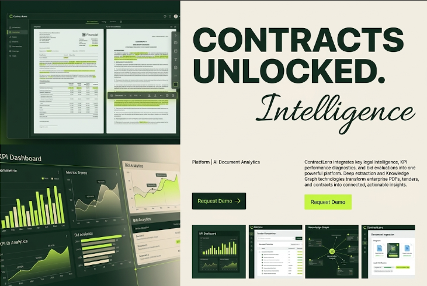

# ContractLens | Enterprise Intelligence

<div align="center">
  
</div>


ContractLens is an integrated AI Document Intelligence Platform that transforms disconnected enterprise documents into actionable, evidence-backed intelligence. The platform unifies document ingestion, AI-driven extraction, and Knowledge Graph/RAG connections to provide deep analytics and risk decision insights.

## 🚀 Features

*   **Document Intelligence:** Ingest and process PDFs, Contracts, CAD files, and Excel spreadsheets.
*   **AI Extraction:** Leverage OCR, NLP, and Computer Vision for automated data extraction.
*   **Knowledge Graph + RAG:** Connect enterprise documents using Retrieval-Augmented Generation for evidence-based responses.
*   **Platform Intelligence Workflow:** Monitor Document Ingestion, Semantic Indexing, and Human-in-the-loop reviews in real-time.
*   **Enterprise Modules:** Built-in tools for KPI Analytics, Bidwise (Tender & RFP Intelligence), and Industrial AI (Maintenance & Asset Intelligence).

## 📁 Project Structure

The repository is organized into a full-stack architecture separated into two main directories:

```text
contractlens/
├── client/           # Next.js frontend (App Router, Tailwind CSS, Lucide React)
├── server/           # Backend services (API, AI/ML models, Database connections)
├── ss.png            # Dashboard screenshot
└── README.md

```

## 🛠️ Tech Stack

**Client (`/client`)**

* **Framework:** [Next.js](https://nextjs.org/) (App Router)
* **Styling:** [Tailwind CSS](https://tailwindcss.com/)
* **Icons:** [Lucide React](https://lucide.dev/)
* **Language:** TypeScript

**Server (`/server`)**

* **Runtime:** Node.js / Python (Depending on AI module requirements)
* **Architecture:** RESTful / GraphQL API architecture for handling document ingestion and RAG queries.

## ⚙️ Getting Started

### Prerequisites

* [Node.js](https://nodejs.org/) (v18 or higher)
* Package manager (npm, yarn, or pnpm)
* Backend dependencies (refer to the server-specific README if applicable)

### 1. Client Setup

Navigate to the client directory, install dependencies, and start the development server:

```bash
cd client
npm install
npm run dev

```

The frontend will be available at `http://localhost:3000`.

### 2. Server Setup

Navigate to the server directory, install the required dependencies, and boot up the backend:

```bash
cd server
npm install
npm run dev

```

*(Note: If your server uses Python/FastAPI for AI workloads, replace the above with your standard `pip install -r requirements.txt` and `uvicorn` commands).*

## 🔐 Environment Variables

You will need to set up environment variables for both the client and server.

Create a `.env` file in the `client/` directory:

```env
NEXT_PUBLIC_API_URL=http://localhost:8000/api

```

Create a `.env` file in the `server/` directory:

```env
PORT=8000
DATABASE_URL=your_database_connection_string
AI_SERVICE_KEY=your_openai_or_custom_llm_key

```

## 📄 License

This project is licensed under the MIT License - see the LICENSE file for details.

```
